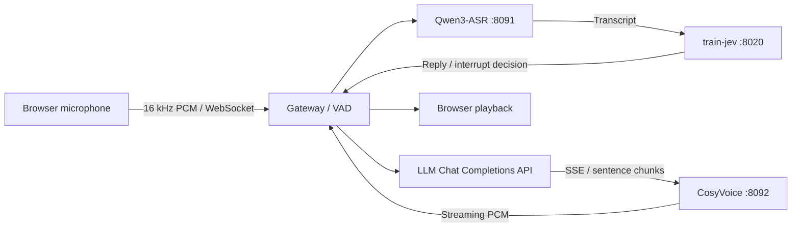

# ASR LLM TTS Agent

A local voice conversation pipeline built with **Qwen3-ASR → LLM API → CosyVoice**, using **train-jev** to decide when to reply or interrupt. Includes a browser microphone client, streaming text and audio, conversation history, and manual interruption.

Inference and training sources for **CosyVoice, Qwen3-ASR, train-jev, and FireRedASR2S** are bundled in `third_party/`, together with the complete Matcha-TTS dependency. This includes local SFT, RL, OPD/OPSD, and Compass training extensions. No additional source checkout or Git submodule initialization is required. Model weights are downloaded separately; the LLM uses an API.

## Quick start

From the repository root, using Python 3.10 or newer:

```bash
python -m venv .venv
.venv/bin/python -m pip install -e .
bash scripts/start.sh --mock
```

If `venv` cannot bootstrap pip, use uv instead:

```bash
uv venv --python 3.12 .venv
uv pip install --python .venv/bin/python -e .
bash scripts/start.sh --mock
```

Open **http://localhost:8090**. Enable the microphone or type a message. Mock mode uses fixed English transcripts and replies plus a test tone; it needs no weights or API key.

## Architecture



The gateway and each model run in separate processes and Python environments. This avoids incompatible Torch/Transformers dependencies. ASR and TTS each serialize model inference; bounded queues overlap LLM output with sentence-level TTS.

```text
voice_agent/          Gateway, model adapters, VAD, and browser client
third_party/          Four model projects, inference/training recipes, licenses, and source manifest
models/               Locally downloaded weights, excluded from Git
scripts/              Launch and repository validation commands
tests/                Unit and loopback HTTP/WebSocket integration tests
docs/protocol.md      Audio formats and event reference
```

## Run real models

### Configuration and weights

```bash
cp .env.example .env
```

Set `LLM_API_KEY`, `LLM_BASE_URL`, and `LLM_MODEL`. The API must support streaming Chat Completions. The gateway appends `/chat/completions` to the base URL and reads SSE text deltas. For a local endpoint without authentication, supply a placeholder key.

| Setting | Default path |
| --- | --- |
| `ASR_MODEL` | `models/Qwen3-ASR-0.6B` |
| `TTS_MODEL` | `models/Fun-CosyVoice3-0.5B` |
| `JEV_BASE` | `models/Qwen3.5-4B` |
| `JEV_ADAPTER` | `models/train-jev-4b-lora` |

See [model downloads](models/README.md). You can point these settings at existing local weights. Source and model paths are resolved relative to the repository root unless absolute paths are supplied. Bundled source locations are configured by `ASR_REPO`, `TTS_REPO`, and `JEV_REPO`.

Set `ASR_LANGUAGE` to force a supported language, or leave it empty for automatic detection. Interface messages and decision prompts are English; multilingual speech remains supported. The bundled reference WAV is Chinese: leaving `TTS_PROMPT_TEXT` empty uses its matching transcript. When replacing the WAV, set its exact transcript and retain the CosyVoice3 `<|endofprompt|>` format. Model vocabularies and language-specific normalization rules retain their original data.

`.env` accepts `KEY=value` and quoted values, without shell expansion. Existing environment variables take precedence. Set `VOICE_AGENT_ENV` to load a different file.

### Model environments

Run installation commands from the repository root. Install hardware-compatible Torch/Torchaudio builds first, especially on Jetson/Orin. The versions in the TTS requirements are the upstream reference pair and may need platform-specific replacement.

ASR (Python 3.10+, preferably 3.12):

```bash
python3.12 -m venv .venv-asr
.venv-asr/bin/python -m pip install -e ./third_party/Qwen3-ASR
.venv-asr/bin/python -m pip install fastapi uvicorn
```

TTS (preferably Python 3.10/3.11):

```bash
python3.11 -m venv .venv-tts
.venv-tts/bin/python -m pip install -r third_party/CosyVoice/requirements.txt
```

JEV (separate Python 3.12+ environment):

```bash
python3.12 -m venv .venv-jev
.venv-jev/bin/python -m pip install -r third_party/train-jev/requirements.txt
```

ASR uses Transformers 4.57.6, TTS uses 4.51.3, and JEV uses 5.x. Keep these environments separate. Training, demos, evaluation tools, and their original dependency specifications are included. The voice application continues to use the ASR Transformers backend and disables TTS TensorRT/vLLM acceleration. FireRedASR2S is available through its own inference and training entry points; see [training and model commands](docs/training.md).

### Start services

```bash
# Terminal 1
bash scripts/start_jev.sh
# Terminal 2
bash scripts/start.sh
```

Default interpreters are `.venv/bin/python`, `.venv-asr/bin/python`, `.venv-tts/bin/python`, and `.venv-jev/bin/python`. Override them through shell environment variables `GATEWAY_PYTHON`, `ASR_PYTHON`, `TTS_PYTHON`, and `JEV_PYTHON`; these Bash variables are not loaded from `.env`. Model paths and JEV service settings are loaded from `.env` by Python.

Alternatively, run each service in its own terminal:

```bash
.venv-asr/bin/python -m voice_agent asr
.venv-tts/bin/python -m voice_agent tts
.venv/bin/python -m voice_agent gateway
.venv-jev/bin/python -m voice_agent.jev
```

Arguments following `start_jev.sh` are passed to the bundled JEV server. Stop `start.sh` to stop its three child processes; stop JEV separately.

### Check readiness

```bash
.venv/bin/python -m voice_agent doctor
.venv-asr/bin/python -m voice_agent doctor --component asr
.venv-tts/bin/python -m voice_agent doctor --component tts
.venv-jev/bin/python -m voice_agent doctor --component jev
curl http://127.0.0.1:8090/ready
```

`doctor` checks dependencies and local paths. `/health` reports gateway liveness; `/ready` checks model services and whether an LLM key is configured. Neither validates real LLM credentials or substitutes for model inference.

## Training and standalone inference

See [docs/training.md](docs/training.md) for all model training families, the shared source launcher, environment requirements, and standalone FireRed inference. Local training extensions from the original working trees are included and marked in the provenance manifest. No training run is started automatically.

## Interruption behavior

After VAD detects the end of an utterance, ASR transcribes it and JEV returns `respond` and `interrupt` probabilities. The default threshold is 0.65. While a reply is being generated or played, only an accepted interruption cancels it; a new reply requires an accepted response decision. Backchannels can leave playback running, while a stop request can stop it without starting a new reply.

Cancellation closes old LLM/TTS requests, clears scheduled client audio, and filters stale output by turn generation. If JEV fails, an idle session may reply but an ongoing reply is preserved. Set `JEV_ENABLED=false` to respond to every utterance and interrupt directly.

Automatic interruption latency includes **VAD silence + ASR + JEV**. The pipeline does not provide incremental ASR or immediate acoustic turn detection. The stop button cancels local playback immediately. Tune VAD settings for your microphone and use headphones to reduce echo.

Microphone access requires localhost or HTTPS. Services bind to 127.0.0.1 by default and have no login authentication. The [protocol reference](docs/protocol.md) describes client messages and audio formats.

## Validation

```bash
.venv/bin/python -m unittest discover -s tests -v
.venv/bin/python tests/smoke_http.py
node --check voice_agent/web/app.js
node --check voice_agent/web/capture-worklet.js
bash -n scripts/start.sh scripts/start_jev.sh
python scripts/check_repository.py
```

Tests use mock model services and API fixtures, require no model downloads or external API calls, and clean up their temporary processes. GitHub Actions runs the same checks. Real ASR was also verified on CPU. Real TTS, JEV, and LLM inference require their environments, weights, and credentials before end-to-end validation.

Weights, `.env`, virtual environments, and generated files are excluded from Git. The repository check verifies vendored file digests and publication candidates. Licenses and provenance are retained in [THIRD_PARTY_NOTICES.md](THIRD_PARTY_NOTICES.md).

## License

[Apache-2.0](LICENSE). Bundled upstream sources retain their original copyright and license notices. Matcha-TTS and its bundled HiFi-GAN code retain their MIT licenses. Upstream code and recipe documentation retain their original contents and language; the application interface and project-level guides remain English. Separately downloaded weights retain their publishers' licenses.

